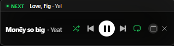

# Spicetify Mini Player

An always-on-top, draggable mini player for Spotify, built with Chromium's Document Picture-in-Picture. It stays visible while Spotify is minimized.

In Settings, **Replace Spotify's mini player** controls whether Spotify's and SpicyLyrics' **Open in Miniplayer** buttons—including episode video controls—open this extension or Spotify's original player.

---

## Capabilities

### Player layouts

- **Standard** (360×185): Artwork, ambient background, timeline, track details, and playback controls.
- **Compact** (440×82): Artwork, track details, timeline, and compact controls.
- **Mini** (360×48): A single-line player with scrolling track details.
- Switch between enabled modes by clicking the artwork or mode button. Drag the player by its header or empty card areas.
- The close button stays in the top bar; queue buttons sit in the former close-button positions in Standard, Compact, and Mini modes.
- In tightly squished dynamic Mini mode, the close and queue controls are replaced by an expand button in the queue control's slot, beside the playback controls; it restores Standard size.
- **Dynamic resizing** is optional. It adapts the layout as the window changes size and provides a button to shrink back to the largest fixed mode.
- In **Settings → Appearance**, choose the **Classic** player style independently of its color theme. **Skeuomorph** and **Adaptive** are optional extensions that add their styles to this menu when installed. Adaptive uses current cover art as a full-bleed background with adjustable blur and a dark legibility scrim, and samples the art for a bright, saturated accent while deemphasizing dark colors. The manual accent remains saved for other styles; if cover pixels can't be read, Adaptive falls back to the theme or saved accent. Its custom-background and blurred-gradient controls are disabled while selected, and any saved custom image is kept for other styles. Its top bar stays sharp over a blurred, theme-tinted surface. Skeuomorph adds glass surfaces, soft aurora glow, glossy tactile buttons, and a raised beveled frame around the album cover; its main background gradients are suppressed when a custom image is active, while the buttons keep their glossy treatment. Choose **Spotify**, **Midnight**, **Ocean**, **Sunset**, **Rose**, or **Mono**; customize the player's main background or accent; toggle the blurred album-art gradient; or choose a local background image that is resized, compressed, and shown below the top bar. Settings controls keep their standard styling.

<details>
  <summary>Preview the layouts</summary>

  **Standard**

  <p align="center">
    
  </p>

  **Compact**

  <p align="center">
    
  </p>

  **Mini**

  <p align="center">
    
  </p>
</details>

### Playback and lyrics

- Timeline, timestamps, playback controls, and volume controls.
- Lyrics from SpicyLyrics or synced LRCLIB data, with a source label and updates as playback advances.
- In Standard mode, choose **Original**, **Romanized**, or **Both** when romanized lyrics are available. English-only lyrics do not show the selector.
- Dynamic resizing scales lyric text up to 2.5×.
- Volume control uses separate mute, low-volume, and high-volume icons.

### Podcasts and video

- Experimental episode-video preview expands to a landscape frame at 690×420 or larger.
- In a shrunk dynamic layout, click the episode thumbnail to expand the player and start video playback.
- If video capture is unavailable or blocked, episode artwork remains visible.

### Queue

- Pins the current track above the upcoming list with a playback indicator.
- Shows the queue snapshot exposed by Spotify. At 100 items, the count becomes a lower bound and the panel warns that more items may exist. Spotify's documented API has no pagination.
- Rows render in batches. Actions check item type and queue identity before playing, reordering, adding, or removing.
- **Play now** moves a manually queued item to the front, then advances playback to preserve the active playlist context.
- Select and remove multiple manually queued items; bulk removal confirms multi-item changes and reports partial failures.
- Drag manually queued items to reorder them. Context tracks cannot be reordered or bulk-selected.
- Album/show/artist navigation and link copying appear only when Spotify provides a valid destination.

### Shortcuts and access

- Configure the mini player toggle shortcut in **Settings → Controls** (default: `Alt + M`).
- The shortcut is ignored while typing in editable fields.
- Open the player from the playbar button or open settings from the topbar button.

---

## Setup & Installation

1. Copy `miniplayer.js` into your Spicetify Extensions directory. To install either optional style, copy its matching file too:
   - **PowerShell (Windows)**:
     ```powershell
     Copy-Item "miniplayer.js" "$env:APPDATA\spicetify\Extensions\miniplayer.js"
     # Optional:
     Copy-Item "miniplayer-skeuomorph.js" "$env:APPDATA\spicetify\Extensions\miniplayer-skeuomorph.js"
     Copy-Item "miniplayer-adaptive.js" "$env:APPDATA\spicetify\Extensions\miniplayer-adaptive.js"
     ```
   - **File Explorer / Run Prompt (Windows)**:
     Copy `miniplayer.js` directly to:
     ```text
     %appdata%\spicetify\Extensions\
     ```
     *(or `%userprofile%\.spicetify\Extensions\` depending on your Spicetify installation)*
   - **Linux / macOS**:
     ```bash
     cp miniplayer.js ~/.config/spicetify/Extensions/
     ```
2. Enable MiniPlayer and any optional theme files you copied, then apply. This command sets the extension list, so include any other extensions you already use:
   ```bash
   spicetify config extensions miniplayer.js miniplayer-skeuomorph.js miniplayer-adaptive.js
   spicetify apply
   ```
   Omit the optional filename(s) for styles you don't want installed. With only `miniplayer.js` enabled, Classic is the only player style.

3. Open the player with the configured shortcut (default: `Alt + M`) or click its playbar icon.

---

## Removal

To disable and remove the extension:
```bash
spicetify config extensions miniplayer.js-
spicetify apply
```

---

## License

This project is released under the terms of the MIT License.
