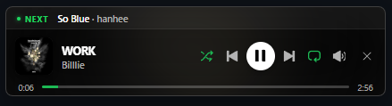

# Spicetify Mini Player

An always-on-top, draggable replacement for Spotify's native mini player, built with Chromium's Document Picture-in-Picture capability. It remains visible and fully responsive even while Spotify is minimized. In the Mini Player settings, toggle **Replace Spotify's mini player** to choose whether Spotify's and SpicyLyrics' **Open in Miniplayer** buttons—including episode video controls—open this extension or Spotify's original player.

---

## Capabilities

- **Always Visible**: Floats above all other windows using native Document PiP.
- **Three Layout Modes**:
  - **Standard Mode (360x185)**: Full view featuring album artwork, ambient background glow, live seek bar with timestamps, track/artist details, heart button, playback controls, and volume controls.
    
    <p align="center">
      
    </p>

  - **Compact Mode (440x82)**: Streamlined bar with album thumb, title and artist, timeline bar, and playback controls.
    
    <p align="center">
      
    </p>

  - **Mini Mode (360x48)**: Ultra-minimal single-line view combining track title and artist with marquee scrolling and controls.
    
    <p align="center">
      
    </p>
- **Lyrics Integration**: Mirrors the active lyric from SpicyLyrics or synced LRCLIB data, replacing stale lines as playback advances. Unsynced SpicyLyrics lines fall back to the line nearest the center of the lyrics view. A small header label shows whether lyrics came from **LRCLIB** or **SpicyLyrics**.
- **Lyric Text Modes**: In Standard Mode, cycle between **Original**, **Romanized**, and **Both** when SpicyLyrics provides romanization. The mode selector is hidden for English-only or otherwise non-romanized lyrics. Both available modes are shown with the romanization underneath, including narrower and shorter resizable layouts when the view has enough height. For variant switching, set SpicyLyrics to **Under each line**.
- **Podcast Video Preview (Experimental)**: Shows accessible Spotify episode video in an enlarged landscape frame once the window reaches at least 690×420 px. Below that size, Compact and Mini layouts keep the same square cover-art sizing used for music and episodes, including 52 px, 42 px, and 24 px fluid variants. Click the episode thumbnail in a shrunk dynamic layout to expand directly to 690×420 px and activate video playback. Music artwork remains square. If capture is unavailable or protected media blocks it, the episode artwork remains visible.
- **Lyrics That Scale with the Window**: With Dynamic Resizing enabled, lyric text grows with larger window sizes, independently of the rest of the interface, up to 2.5x its base scale.
- **Compact Controls**: Uses dedicated mic-vocal and Lucide-style volume icons. The volume button switches between mute, low volume at 60% or below, and high volume above 60%.
- **Dynamic Resizing**: An experimental setting that lets the window resize freely, switches between Mini, Compact, and Standard layouts, scales the interface, and shows a larger album-art layout when tall. A top-bar button can shrink the window back to the largest fixed mode.
- **Fluid Video Layout**: Expanded podcast-video layouts reserve space for the landscape preview and position the timeline beneath it, while music and non-video podcasts use the raised timeline position.
- **Next Up Display**: Shows upcoming queue items in a top bar by reading the queue directly.
- **Smooth Playback**: Powered by `requestAnimationFrame` for timeline updates without unneeded DOM manipulation.
- **Native Dragging**: Move the player anywhere on screen using header or empty card areas.
- **Fast Access**:
  - Shortcut: `Alt + M` (disabled while typing in inputs)
  - Playbar button next to Spotify queue and lyrics
  - Topbar settings button

---

## Setup & Installation

1. Copy `miniplayer.js` into your Spicetify Extensions directory:
   - **PowerShell (Windows)**:
     ```powershell
     Copy-Item "miniplayer.js" "$env:APPDATA\spicetify\Extensions\miniplayer.js"
     ```
   - **File Explorer / Run Prompt (Windows)**:
     Copy `miniplayer.js` directly to:
     ```text
     %appdata%\spicetify\Extensions\
     ```
     *(or `%userprofile%\.spicetify\Extensions\` depending on your Spicetify installation)*
   - **Linux / macOS**:
     ```bash
     cp miniplayer.js ~/.config/spicetify/Extensions/
     ```
2. Enable the extension and apply:
   ```bash
   spicetify config extensions miniplayer.js
   spicetify apply
   ```

3. Toggle the player anytime in Spotify with `Alt + M` or by clicking the mini player icon in the playbar.

---

## Removal

To disable and remove the extension:
```bash
spicetify config extensions miniplayer.js-
spicetify apply
```

---

## License

This project is released under the terms of the MIT License.
